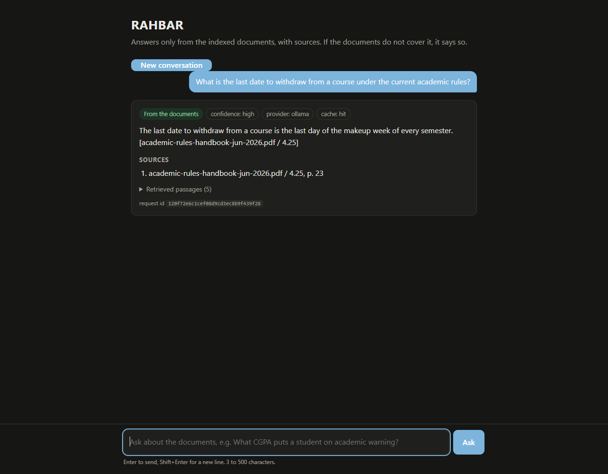
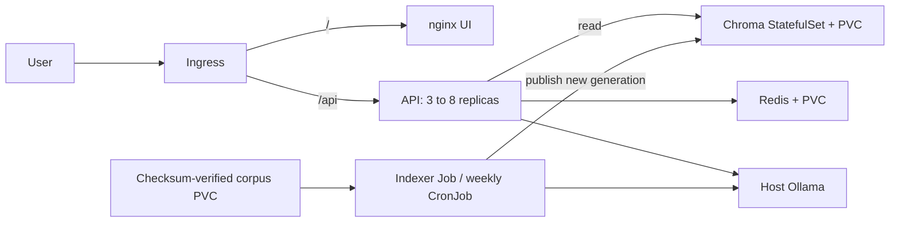

# RAHBAR

[](https://github.com/Jibran3134/Rahbar/actions/workflows/ci.yml)

RAHBAR answers FAST-NUCES policy questions from seven verified public documents instead of relying on a model's general knowledge. It distinguishes current and historical rules, returns request-verified citations, and declines when the selected evidence is insufficient. A separate indexing Job publishes versioned Chroma collections; three API replicas share Redis conversations/cache and serve a small chat UI through Kubernetes Ingress. Team: **Jibran** (application/RAG) and **Alishba** (platform/delivery). Codex implemented the current work at Jibran's request; human review remains pending.

Local minikube and CI-equivalent kind verification are recorded under [platform evidence](docs/evidence/platform). **[PR #1](https://github.com/Jibran3134/Rahbar/pull/1) demonstrated a blocked evaluation regression, passed after correction and merged through required CI. [CD passed](https://github.com/Jibran3134/Rahbar/actions/runs/42090196319), publishing the three SHA-tagged Docker Hub images and validating their rollout/Ingress/evaluation in an ephemeral cluster.** [Submission links and remaining rubric exceptions](docs/SUBMISSION.md) are recorded separately. Live remote runs are linked under P05 evidence; earlier P01-P04 reports describe their historical local-only checkpoints.



## Run the app on Windows

After installing the prerequisites below once, run this from the repository folder:

```powershell
.\run.cmd
```

The launcher starts Docker Desktop/Ollama if needed, downloads missing models, starts the dedicated Rahbar Kubernetes profile, builds/deploys/indexes on first use, waits for readiness, and opens **http://localhost:8090**. It serves the real corpus with Ollama through the actual Kubernetes Ingress. No hosts-file edit, administrator terminal or separate port-forward command is needed for normal startup. Docker Desktop may request its own first-time OS setup/elevation.

Keep the terminal open; Ctrl+C closes browser access without deleting indexed data or stopping shared services. Later starts reuse the existing deployment/index. First provisioning and model downloads can take several minutes and require internet. After changing application/image/configuration source, use `.\run.cmd -Rebuild` to rebuild and apply; reindex corpus changes with the existing `scripts/dev.ps1 index` command. Use `-Port 8091` if port 8090 is occupied, `-NoBrowser` to suppress opening a tab, or `-CheckOnly -NoBrowser` for a startup smoke that exits and closes its own forwarding processes.

The commands below describe individual setup, testing and diagnostic operations; they are not a daily startup checklist.

## Architecture

See the [complete assignment workflow](docs/WORKFLOW.md) for startup, indexing, question answering, Kubernetes controls and CI/CD, with downloadable PNG/SVG and editable Mermaid source.



The API never indexes on startup. Chroma/Redis remain ClusterIP-only. Calico enforces default-deny with explicit DNS, Ingress, API/state and model-host paths; the UI cannot connect to Chroma. Workloads use distinct service accounts without API tokens, non-root users, read-only roots, dropped capabilities, writable bounded temporary mounts and CPU/memory requests/limits. [Architecture](docs/ARCHITECTURE.md) and [ADR 0001](docs/adr/0001-indexer-as-job.md) explain persistence, publication and failure limits.

## Windows prerequisites

Use native Windows PowerShell, Docker Desktop **Linux containers**, Git, kubectl, Python **3.12**, Node.js 18+ and Windows Ollama. Ubuntu/WSL terminals and GNU Make are not required. Docker Desktop may use WSL internally. Allow roughly 6 GiB/four CPUs for minikube plus host-model capacity; the tested Docker engine exposes 12 CPUs and about 16 GiB. The optional screenshot utility needs installed Chrome and Node 22+.

Install Python 3.12 with the Python launcher before a fresh setup. This existing workspace has an isolated .venv interpreter; do not replace it with global Python 3.14. The scripts install checksum-locked minikube, kind, kubeconform, Trivy and actionlint into ignored .venv/tools/bin. They do not install global executables.

```powershell
git clone https://github.com/Jibran3134/Rahbar.git
cd Rahbar
powershell -NoProfile -ExecutionPolicy Bypass -File scripts/dev.ps1 setup
powershell -NoProfile -ExecutionPolicy Bypass -File scripts/dev.ps1 tools
powershell -NoProfile -ExecutionPolicy Bypass -File scripts/dev.ps1 test
powershell -NoProfile -ExecutionPolicy Bypass -File scripts/dev.ps1 lint
powershell -NoProfile -ExecutionPolicy Bypass -File scripts/dev.ps1 manifests
```

Start Ollama and provision the two selected models:

```powershell
ollama pull nomic-embed-text
ollama pull llama3.2:3b
Invoke-RestMethod http://127.0.0.1:11434/api/tags
```

Native Docker Desktop tests reached the existing Windows listener through host.minikube.internal without changing its binding. Other installations may require a Docker-reachable listener/interface; verify the endpoint from a pod rather than assuming localhost means the Windows host. Both workloads must use the same nomic embedding name and actual dimension (768). Mutable model names are not digest enforcement; tested digests are in application evidence.

## Clean-clone deployment and exact apply order

```powershell
powershell -NoProfile -ExecutionPolicy Bypass -File scripts/dev.ps1 cluster
powershell -NoProfile -ExecutionPolicy Bypass -File scripts/dev.ps1 images
powershell -NoProfile -ExecutionPolicy Bypass -File scripts/dev.ps1 apply
```

The cluster task starts profile rahbar with Docker, Calico, Kubernetes v1.37.0, ingress and metrics-server. All resource operations use explicit context rahbar. The image task builds three independent contexts, tags them with the current Git SHA by default and loads them into minikube. For uncommitted development use an explicit tag consistently on both images/apply, e.g. `-Tag dev`.

The apply helper renders the overlay into ignored .venv/platform/dev and applies in this order:

1. Namespace rahbar.
2. ServiceAccounts, ConfigMaps, PVCs, ClusterIP Services, state workloads, API/UI deployments, policies, HPA, Ingress and CronJob. Initial APIs remain unready while no published index exists.
3. Wait for Chroma and Redis readiness.
4. Apply the one-shot indexer Job. Its init container fetches/checks the seven manifest snapshots into the corpus PVC; the main container runs extraction/OCR/clean/chunk/embed/store. Wait for Job completion.
5. Wait for all API/UI rollouts. Readiness now checks nonempty compatible index data, actual query dimension and Redis.

```powershell
kubectl --context rahbar -n rahbar get pods
kubectl --context rahbar -n rahbar get endpoints api
kubectl --context rahbar -n rahbar get hpa
kubectl --context rahbar -n rahbar logs job/indexer -c fetch-corpus
kubectl --context rahbar -n rahbar logs job/indexer -c indexer
```

A completed bootstrap Job has an immutable template; reapplying preserves it. Later image updates change Deployments/CronJob, and a new indexing run uses the CronJob template below. Never use --dummy for final deployment/CI: it does not publish the required active identity.

For a fresh cluster, these are the equivalent explicit `kubectl apply` commands. Rendering creates inspectable phase files; the helper above performs the same dependency ordering:

```powershell
.venv/Scripts/python.exe scripts/deploy.py render --overlay dev --tag (git rev-parse HEAD)
kubectl apply --context rahbar -f .venv/platform/dev/namespace.yaml
kubectl apply --context rahbar -f .venv/platform/dev/foundation.yaml
kubectl rollout status statefulset/chroma --context rahbar -n rahbar --timeout=900s
kubectl rollout status deployment/redis --context rahbar -n rahbar --timeout=900s
kubectl apply --context rahbar -f .venv/platform/dev/indexer.yaml
kubectl wait --for=condition=complete job/indexer --context rahbar -n rahbar --timeout=1800s
kubectl rollout status deployment/api --context rahbar -n rahbar --timeout=600s
kubectl rollout status deployment/ui --context rahbar -n rahbar --timeout=600s
```

The model-host policy defaults to the observed **192.168.65.254/32**, TCP 11434. Confirm your host address with `.venv/tools/bin/minikube.exe ssh -p rahbar -- getent hosts host.minikube.internal`. If it differs, use `scripts/dev.ps1 apply -HostCidr <actual-IP>/32 -OllamaUrl http://host.minikube.internal:11434`. The API/indexer must share this URL. Do not replace the narrow model rule with unrestricted egress.

## Manual Ingress access (optional diagnostics)

Normally use `.\run.cmd` for automatic localhost access. For manual Ingress troubleshooting, in another terminal:

```powershell
kubectl --context rahbar -n ingress-nginx port-forward service/ingress-nginx-controller 8085:80 --address 127.0.0.1
```

This forwards the actual Ingress controller, not the API directly. Requests need Host rahbar.local:

```powershell
$headers = @{ Host = 'rahbar.local' }
$body = @{ question = 'What is the last date to withdraw from a course under the current academic rules?' } | ConvertTo-Json
Invoke-RestMethod http://127.0.0.1:8085/api/ask -Method Post -Headers $headers -ContentType application/json -Body $body
$absent = @{ question = 'What is the hostel room booking deadline?' } | ConvertTo-Json
Invoke-RestMethod http://127.0.0.1:8085/api/ask -Method Post -Headers $headers -ContentType application/json -Body $absent
```

For the browser add `127.0.0.1 rahbar.local` to the Windows hosts file using an elevated editor, then open http://rahbar.local:8085. No system hosts file is changed by the scripts. Alternatively use minikube tunnel in its own terminal and follow its elevation prompt, with the same hostname on port 80. Docker-driver node IPs are not directly reachable from a Windows browser. Stop a port forward/tunnel with Ctrl+C.

The UI defaults to **Independent question**: each submission omits conversation history, so an eligible repeated question can produce MISS then HIT without clearing the thread. Choose **Conversation / follow-up** to use the previous question/session; contextual turns deliberately return BYPASS. **New conversation** resets browser-held session state. Shared turns reside in Redis. The UI renders model/source strings as text.

Cache status also includes a plain-language explanation (`X-Cache-Reason` in HTTP). `miss_stored` means the verified answer was stored and can be reused; `matched` means HIT. Refusals, generation fallbacks, low-confidence output and follow-ups are not cached. A first request that times out or fails validation can therefore MISS again until a safe answer is generated. Similarity must still clear .95 with matching scope/version/numeric guards and the same active generation/configuration; not every paraphrase should hit. The launcher preloads the generation model before opening the browser to reduce cold-start delays.

## Reindex without an API redeploy

```powershell
powershell -NoProfile -ExecutionPolicy Bypass -File scripts/dev.ps1 index
# Equivalent manual trigger:
kubectl --context rahbar -n rahbar create job --from=cronjob/reindex manual-reindex-unique-name
```

The CronJob runs Sunday 02:00 UTC with concurrencyPolicy Forbid. The application writer lock also covers separate manual Jobs. Old readers remain on validated generations until a replacement is published; cache namespaces change on publication. A crashed writer can leave a lock: verify all writers stopped before manual recovery. Do not delete an uncertain new generation or steal a lock based on age. Previous/failed generations are retained until an explicit safe cleanup.

## Configuration and API

Real defaults: chunks **250/30**, top-k **5**, relevance floor **.74**, cache threshold **.95**, temperature **.2**, llama3.2:3b, nomic-embed-text. Settings are in k8s/base/configmap.yaml and read at process start. Restart affected API pods after changing configuration. Unsupported hosted/in-cluster generation modes fail configuration; the CI embedding server is reached through OLLAMA_URL with generation explicitly stubbed.

| Method | Path | Behavior |
| --- | --- | --- |
| POST | /api/ask | JSON question (3-500 chars), optional nullable session_id; answer/citations/confidence/retrieved metadata; no reasoning |
| GET | /api/info | Read-only runtime settings and active index identity |
| GET | /healthz | Process-only liveness; direct API Service/pod endpoint |
| GET | /readyz | Compatible index, embedding dimension and Redis; 503 when unavailable |
| GET | /metrics | Prometheus HTTP/stage/cache/refusal/fallback/token metrics |

Ingress routes /api to API and / to UI. Probe/metrics endpoints are internal API endpoints; use a separate temporary API Service port forward for debugging them. Responses include X-Request-ID, X-Cache HIT/MISS/BYPASS and X-Cache-Reason. X-Bypass-Cache:true supports clean regression runs.

Redis retains up to six bounded turns with a default 1800-second TTL. Cache candidates are bounded to 256 per namespace with 3600-second logical TTL/key expiry; logical expiry does not promise immediate physical erasure or backup deletion. IDs are bearer access to conversations, not authenticated identities.

No real Secret is applied from Git. The selected host provider needs no API key. If documenting the optional compatibility Secret, supply a value from a process variable, never from a committed YAML:

```powershell
kubectl --context rahbar -n rahbar create secret generic rahbar-secret --from-literal="LLM_API_KEY=$env:LLM_API_KEY"
```

k8s/secret-placeholder.yaml is excluded from Kustomize. Do not apply it over a real Secret. Selecting hosted mode remains unsupported even if a key is present.

CPU generation is allowed 120 seconds per attempt, with at most one validation retry. Ingress, the Windows gateway and the evaluator use 360-second read budgets. A generation deadline still produces a safe, uncached fallback, now explained as `generation_timeout`. Title-only PDF matches are expanded with bounded facts from the same source page/version; scores and citation identities remain those of the matched headings.

The exact model JSON shape, completion checks and public response rules are documented in [MODEL-RESPONSE-CONTRACT.md](docs/MODEL-RESPONSE-CONTRACT.md). A valid structured response is still subject to evidence/citation checks; no fixed wording or perfect semantic accuracy is promised.

## Evaluation and CI/CD

```powershell
powershell -NoProfile -ExecutionPolicy Bypass -File scripts/dev.ps1 eval
# Independent, fresh CI-equivalent fixture environment:
powershell -NoProfile -ExecutionPolicy Bypass -File scripts/dev.ps1 e2e -Tag <built-image-tag>
```

The real evaluator uses eval/golden.yaml and eval/baseline.json. The kind fixture environment uses its own Ollama embeddings, Chroma publication, stub generation, explicit floor .65, eval/fixtures/golden.fixture.yaml and eval/fixtures/baseline.json. No developer host model/account is required for CI. The helper retains the owned local kind cluster for inspection and uses .venv/e2e/kubeconfig, preserving the normal kubeconfig. An existing rahbar-ci cluster requires deliberate review/resume; it is never deleted automatically. The remote ephemeral runner is discarded after its job.

The shipped real native baseline is recall@3/@5 **.933333**, citation integrity **1.0**, required abstentions **1.0**. Ordinary recall is .875, other answerable categories 1.0. Five original expect-string misses remain recorded, including a conservative scan refusal, a verification fallback and an incomplete historical heading; later runs can differ. Perfect citation syntax is not perfect answer correctness. Fixture scores are all 1. See [pipeline measurements](docs/PIPELINE.md), [failure analysis](docs/FAILURE-ANALYSIS.md) and actual result files for limitations.

CI runs on PRs to dev/main and pushes to dev. It gates Ruff/mypy/workflow syntax, tests with >=60% coverage, strict Kustomize/kubeconform, builds without publishing, Trivy fixable HIGH/CRITICAL scans and actual kind/Ingress fixture evaluation. Local coverage.py results are API 90.12%, indexer 90.26%; all three fixed images passed the scan gate. CD on main depends on the complete verifier, promotes the same scanned image artifacts to **docker.io/jibran3134/rahbar-{api,indexer,ui}:<40-character-Git-SHA>**, then pulls those exact published images into an ephemeral cluster for rollout/Ingress/eval checks. It never deploys :latest.

Configure GitHub Actions secrets DOCKERHUB_USERNAME=jibran3134 and DOCKERHUB_TOKEN using a Docker Hub access token. Never paste the token into chat or commit it. The assignment requires PRs, passing CI and one approval. Jibran explicitly requested zero required approvals; current protection therefore enforces PRs and seven GitHub-Actions-bound checks for administrators too, with approval count zero. The assignment's one-approval criterion remains unmet by that choice. Development now follows topic branches (fix/, feat/, docs/ or chore/) -> PR into dev -> PR into main, using merge commits and passing automated checks at both stages; no teammate approval is required. See [AGENTS.md](AGENTS.md). The regression/fix PR and successful registry/CD links are recorded only after actual completion. Required submission links: [repository](https://github.com/Jibran3134/Rahbar), successful CD run, and three Docker Hub image pages showing SHA tags. Do not substitute local evidence for those links.

For SHA-tagged registry deployment to the local real profile:

```powershell
.venv/Scripts/python.exe scripts/deploy.py apply --overlay prod --tag <full-Git-SHA> --registry docker.io/jibran3134 --context rahbar
```

This is distinct from the ephemeral CI fixture demonstration. Provide registry pull access if repositories are private; the CD runner loads authenticated pulls into kind, while a persistent cluster needs its own reviewed pull-secret setup.

## Operations, evidence and attribution

Diagnose in order: `kubectl --context rahbar -n rahbar get pods`, describe the failing pod/Events, then logs (add --previous for a crashed container). Model mismatch yields live-but-unready new pods and explicit expected/actual diagnostics; old replicas can remain available during the stalled zero-unavailable rollout. Restore the shared pin before restarting again. A single Chroma/Redis replica can cause temporary dependency outages during replacement; persistence is not high availability.

Resource requests/limits and HPA reasoning use real [kubectl top and cgroup evidence](docs/evidence/platform/P02), including a 327.90-MiB observed indexer cgroup peak against 1536 MiB. This finite sample is not a universal memory bound. [Engineering notes](docs/ENGINEERING-NOTES.md) answer all seven assignment questions. [Platform experiments](docs/evidence/platform/P04) record network denials, shared sessions/cache, deletion/persistence, mismatch recovery, reindexing and visible rollout/rollback. Run `scripts/dev.ps1 check` before submission; the supplied checker is unchanged and is not the rubric.

Third-party PDFs/HTML/extracted text are ignored, not redistributed in Git. URLs/checksums and a fail-closed snapshot fetcher are committed; changed remote bytes require source review rather than silently refreshing golden truth. Read [corpus provenance](docs/CORPUS.md), [licensing status](LICENSE) and the [AI disclosure](docs/AI-USAGE.md). Core ownership/planning history remains in docs/IMPLEMENTATION-PLAN.md and both named ledgers. Linux convenience commands are in Makefile; Windows commands above are the tested primary path.
