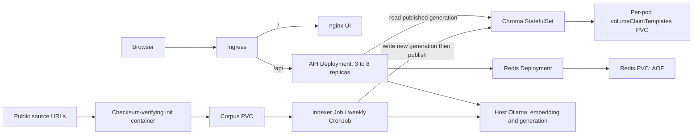

# RAHBAR architecture

Jibran owns the RAG implementation; Alishba's platform scope is being implemented by Codex at Jibran's request. Linux containers run from native Windows/PowerShell development. The real local profile uses minikube with Calico and external Windows Ollama; CI provisions its own embedding server and uses deterministic grounded stub generation.

The API only reads the vector store. A single-writer Job builds a new collection, verifies it and publishes active collection/generation/model/dimension. Readiness validates that identity and actual query-vector compatibility. The cache namespace includes generation/model/provider/prompt/settings, so new data cannot reuse an old generation's answers. See ADRs 0001-0004 for failure/retention limits.

Chroma is a one-replica StatefulSet with a volumeClaimTemplates claim, stable pod identity and a headless ClusterIP Service. This gives the single persistent store a stable attachment and identity through pod replacement; it does not create database high availability or multi-writer safety. Redis uses a Recreate Deployment with one RWO PVC and append-only persistence. An ordinary Redis pod restart preserves state subject to Redis's every-second AOF durability window. Neither data service is exposed outside ClusterIP.

Base manifests define four Services, five distinct service accounts, namespace rahbar, restricted non-root/read-only containers, bounded /tmp volumes, requests/limits and API HPA 3-8 at 70% CPU. API rolling updates use maxSurge 1/maxUnavailable 0, a ten-second preStop drain and 140-second termination grace. Each model call has a 60-second configured timeout; two validation attempts plus drain fit within this grace under normal operation, without a hard real-time guarantee.

Default-deny ingress/egress is followed by DNS TCP/UDP 53, Ingress-to-UI/API, UI-to-API, API/indexer-to-Chroma and API-only-to-Redis rules. Model-host egress is restricted to a configured /32 on TCP 11434; the local tested host address is 192.168.65.254. The corpus init container needs public HTTPS to the checksum-locked source URLs. All workload pods disable automatic API-token mounting. No real Secret is included in Kustomize; the optional compatibility Secret template is documentation only.

The CI overlay mounts three committed Markdown fixtures, suspends scheduled reindexing, uses relevance floor .65 and stub generation, and adds a pinned isolated Ollama embedding server. CI therefore evaluates actual extraction/chunking/embedding/publication/retrieval and citation validation, rather than the fixed stub retriever. Its separate golden/baseline pair must never overwrite the real .74-profile results. The real profile uses chunks 250/30, top-k 5, cache threshold .95 and llama3.2:3b. Both profiles share the same nomic embedding name.

Windows minikube Docker-driver networking does not expose node addresses directly. The documented loopback port forward reaches the actual Ingress controller with Host rahbar.local; minikube tunnel plus a hosts entry is another interactive option. scripts/deploy.py renders runtime image tags/host settings in ignored .venv storage, applies namespace/state before the initial Job, then waits for API/UI rollouts. The default Kubernetes context is preserved. CI's kind cluster uses an isolated kubeconfig and loopback Ingress port 18080.

Resource settings began conservatively and are assessed against actual kubectl top/cgroup evidence. The real first indexing Job peaked at 327.90 MiB in observed cgroup memory.peak samples against 1536 MiB, including OCR subprocesses. This is a finite observed workload, not proof of a universal bound. API CPU reflects Python retrieval/validation and network activity; waiting on external generation does not become model CPU in the pod. HPA does not scale the external host model.

CI performs lint/types, offline tests with >=60% coverage, strict manifest validation, image builds, fixable HIGH/CRITICAL scans and live fixture Ingress evaluation. CD depends on that verification, promotes the same scanned image artifacts under the Git commit SHA, then tests those published images in an ephemeral cluster. Remote GitHub protection, registry credentials, a blocked regression PR and a successful remote CD link require actual account actions/evidence; local implementation is not proof they occurred.

References: [Kubernetes security contexts](https://kubernetes.io/docs/tasks/configure-pod-container/security-context/), [minikube Docker-driver networking](https://minikube.sigs.k8s.io/docs/drivers/docker/). Runtime results and known answer-quality limits are in docs/evidence/app and docs/evidence/platform.
