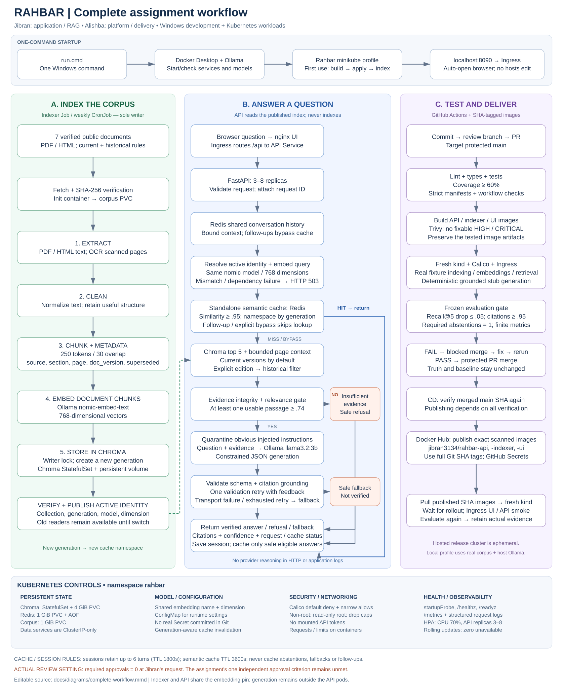
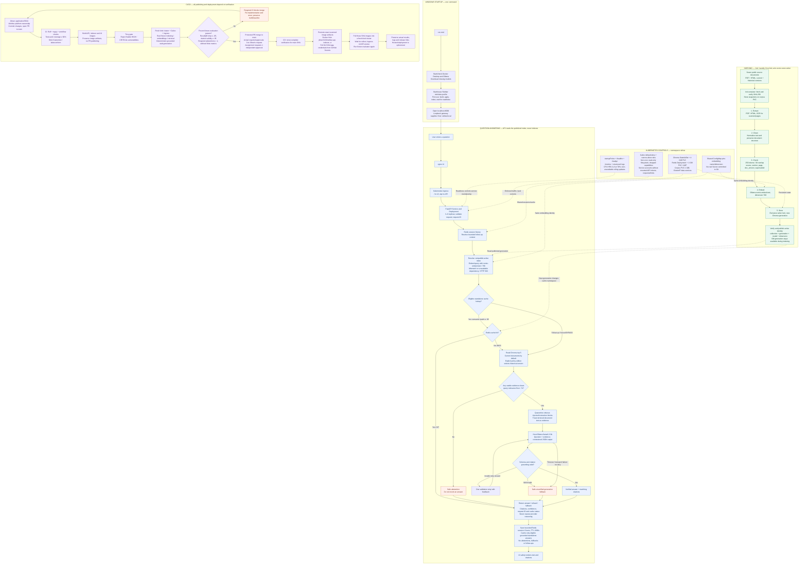

# RAHBAR complete assignment workflow

Team ownership: **Jibran** - application/RAG; **Alishba** - platform/delivery. The diagram describes the implemented design, including current departures from assignment review requirements. Ownership labels do not assert personal authorship; see AI-USAGE.md.

[PNG image](diagrams/complete-workflow.png) | [Scalable SVG](diagrams/complete-workflow.svg) | [Editable Mermaid source](diagrams/complete-workflow.mmd)

Read left to right by lane: **A** prepares and publishes the corpus; **B** answers user questions; **C** tests, protects and releases the implementation. The bottom band shows the Kubernetes controls shared by the workloads.

- `run.cmd` is the normal Windows startup command. It opens localhost:8090 through a loopback gateway to the real Kubernetes Ingress. The first run prepares the deployment; later runs reuse it.
- Only the indexing Job/CronJob writes vector generations. It extracts, cleans, chunks, embeds and stores, then publishes a validated active identity. The API never indexes at startup.
- The UI defaults to independent questions (no session ID sent), enabling safe repeat cache hits without clearing the visible thread. Conversation mode sends the server-issued session ID and contextual turns bypass cache.
- The question path resolves shared Redis history and checks the active embedding identity. Query embedding is needed even for semantic cache lookup. A cache hit skips vector retrieval and generation; follow-ups and forced bypasses skip cache lookup.
- A query fails the relevance gate when no usable retrieved passage clears .74. This is a query-level gate: it does not remove every lower-scoring passage once another passage clears the floor.
- Generation is evidence-only with obvious instruction blocks quarantined. Schema/citation failures get one validation retry; transport/timeouts fall back immediately. Citation validation is not proof that every factual statement is semantically complete.
- Only eligible grounded standalone answers enter semantic cache. Cache namespaces include active generation/model/settings. Redis sessions are shared across replicas.
- CI uses its separate frozen fixture truth/baseline, real embeddings and retrieval, with grounded stub generation. Real local evaluation uses the real corpus/Ollama and its own truth/baseline; these reports are not interchangeable.
- CD reruns verification for the merged SHA, promotes those exact scanned image artifacts, and pulls them into an ephemeral kind cluster for rollout/Ingress/evaluation. It is not permanent public hosting.
- The assignment asks for an independent approval. Actual protection requires zero approvals at Jibran's request, while required CI remains enforced. The diagram does not claim independent approval was obtained.

Implementation references: [indexing](../indexer/pipeline/run.py), [generation](../api/app/services/generation.py), [cache](../api/app/services/cache.py), [retrieval](../api/app/retrieval/chroma.py), [startup](../scripts/run_app.py), [CI](../.github/workflows/verify.yml), [CD](../.github/workflows/cd.yml), and [architecture](ARCHITECTURE.md).

## Editable complete diagram

